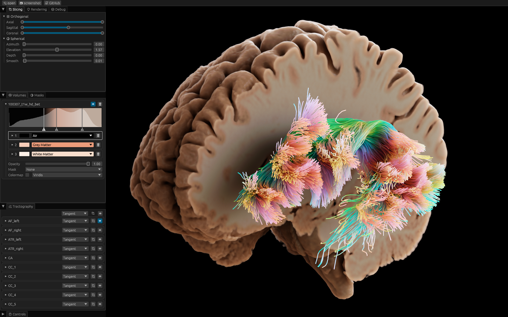
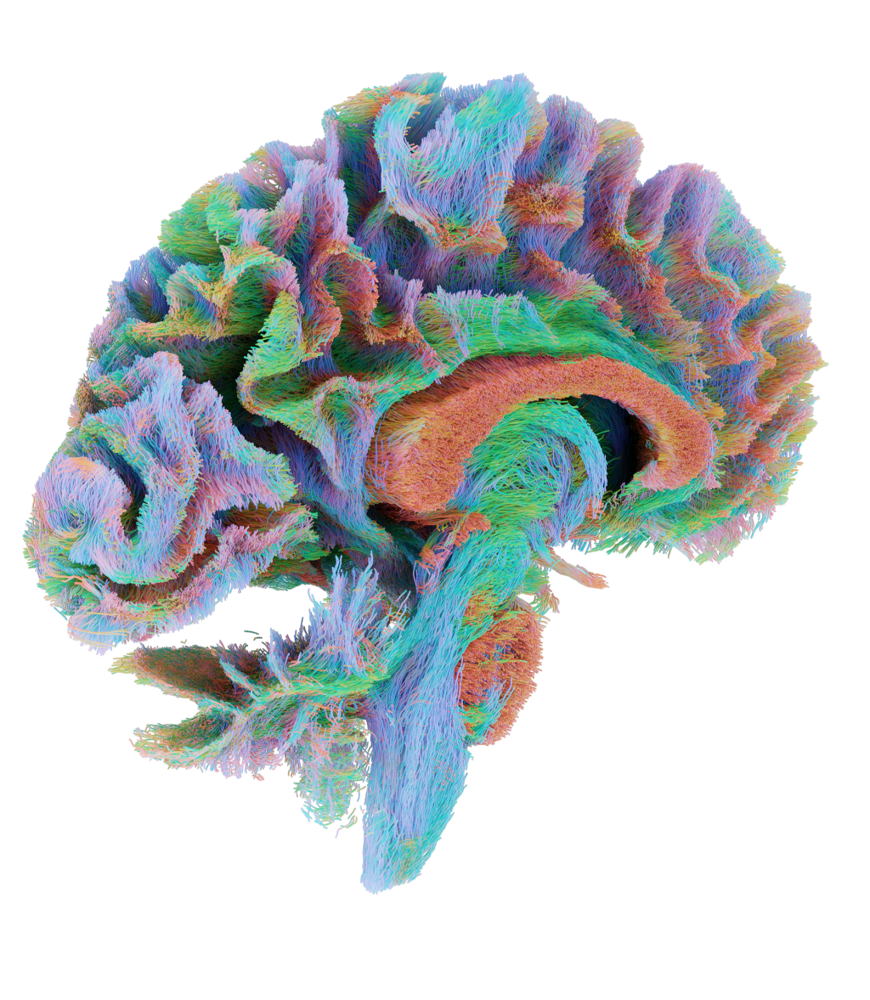
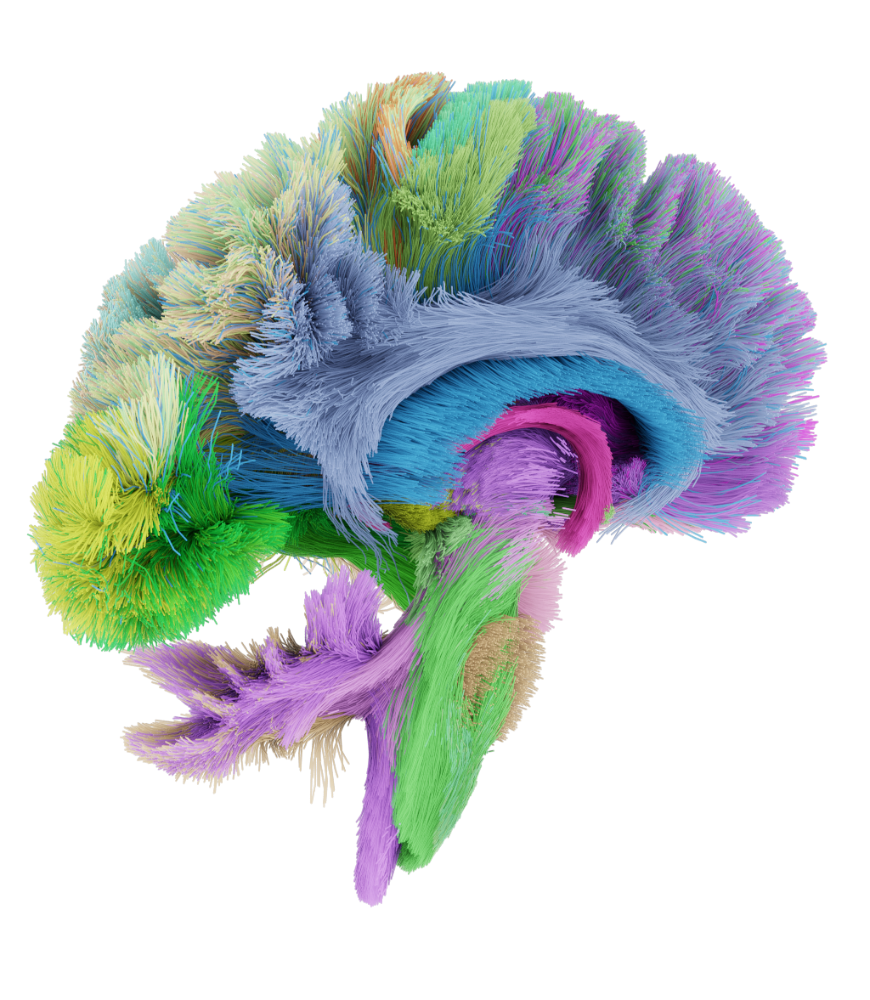
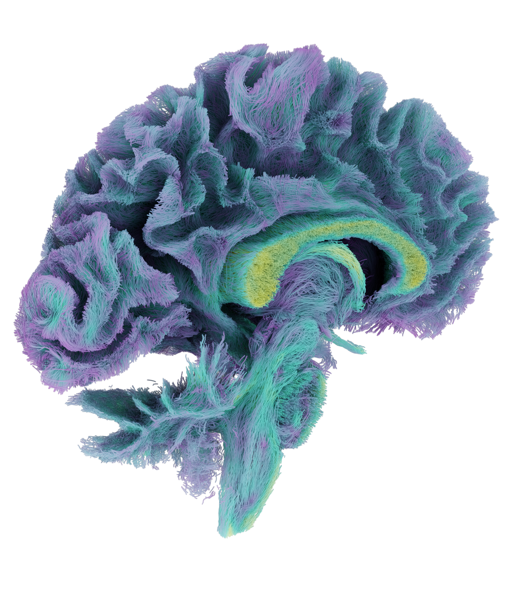

# VIBRANT — Cinematic Neuroanatomy & Tractography

<p align="center">
    
</p>

<p align="center">
  <strong>VIBRANT: Real-Time Cinematic Visualization of Neuroanatomy and Tractography</strong>
</p>

<p align="center">
  <a href="https://vibrant.software/">Visit the Web App at vibrant.software</a>
</p>

---

## What is VIBRANT?

VIBRANT is a visualization tool focussing on medical volume rendering and tractography.

### Rendering

VIBRANT provides open-source real-time physically-based rendering of medical volumes on the web, highlighting the depth and shape of your datasets, while remaining interactive on your laptop! VIBRANT allows you to configure how to render your data to create publication ready output for your papers and presentations. just don't forget to [cite us](#citation), when you do ;).

### File Support

- **Medical Volumes** (.nii.gz)
- **Scientific Volumes** (.nrrd)
- **dMRI Tractography** (.tck/.tsf)
- [Environment Maps](https://polyhaven.com/hdris) (.exr)

### The User Interface

VIBRANT lets you load multiple volumes and tractograms, configure their appearance using the histogram, cropping, and rendering settings, and export a screenshot to spice up your research.

<p align="center">
  
</p>


> [!NOTE]  
> VIBRANT is in active development and its output and UI will change over time.

---

## Demo Video

Demo video showcasing a typical workflow when visualizing a T1 MRI Scan and Tractography.

[](https://www.youtube.com/watch?v=BcidW6gWCrM)

---

## Running the App

VIBRANT runs on all platforms, web and native, exposing the same feature set anywhere!

### Web

Visit **https://vibrant.software/**

> [!NOTE]  
> VIBRANT is based on WebGPU and currently only runs in Google Chrome.

### Desktop

#### Build from Source

VIBRANT can be built from source using Rust on Windows/Mac/Linux:

1. [Install Rust](https://rustup.rs/)
2. Build and run:

    ```bash
    git clone git@github.com:as-the-crow-flies/vibrant.git
    cd vibrant
    cargo run
    ```

#### Pre-Built Binaries

(coming soon)

---

## Features

### Volume Rendering

Load scalar NIfTI volumes (`.nii.gz`) or Nearly Raw Raster Data (`.nrrd`) files for direct volume rendering. A histogram-based transfer-function editor controls which intensities are visible and how they appear on screen, while environment lighting and material settings highlight the three-dimensionality of the data.

| Standard volume rendering | With cinematic lighting |
| --- | --- |
|  |  |

### Tractography

Load one or many Tractograms (`.tck`) and render them as lit tubes with shadows and ambient occlusion, so crossing and fanning geometry stays legible. Each bundle can be shown, hidden, coloured, and sliced on its own.

Streamlines can be coloured by **tangent direction**, by a **fixed colour per bundle**, or by a **Track Scalar File** (`.tsf`)

| Tangent direction | Per-bundle colour | Track scalar (`.tsf`) |
| --- | --- | --- |
|  |  |  |

### Slicing

Explore interior structure with orthogonal (axial / sagittal / coronal) clip planes and/or a spherical cutaway.

### Masking

Any NIfTI whose filename contains `mask` is loaded as a mask and can be assigned to one or more volumes to restrict them to a region of interest. Both binary and signed-distance masks are supported.

---

## Citation

If you use VIBRANT in academic work, please cite [our paper](https://doi.org/10.1111/cgf.70372):

```bibtex
@article{https://doi.org/10.1111/cgf.70372,
  author  = {Kraaijeveld, B. and Jalba, A.C. and Vilanova, A. and Chamberland, M.},
  title   = {Real-Time Rendering of Dynamic Line Sets using Voxel Ray Tracing},
  journal = {Computer Graphics Forum},
  volume  = {n/a},
  number  = {n/a},
  pages   = {e70372},
  doi     = {https://doi.org/10.1111/cgf.70372},
  url     = {https://onlinelibrary.wiley.com/doi/abs/10.1111/cgf.70372},
  eprint  = {https://onlinelibrary.wiley.com/doi/pdf/10.1111/cgf.70372}
}
```

## Acknowledgements

This work was funded by the Dutch Research Council (NWO), grant **OCENW.M.22.352**, awarded to Maxime Chamberland.
